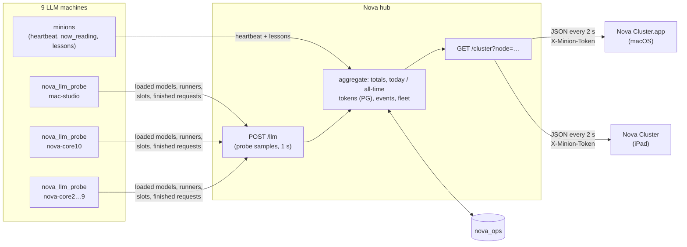

# Nova Cluster — Mac + iPad

A live view of what Nova's whole cluster is doing with its language models, and what that
work becomes. Every machine's Ollama/llama.cpp traffic (models in memory, requests being
served right now, finished requests) and the minions' reading work (jobs, tonight's works
and lessons, the latest lesson) arrive from Nova's hub every 2 s. Display only: it never
computes anything. Sibling of [Nova Minion](../NovaMinionPad/) (same near-black space look).

One multiplatform xcodegen project. The `NovaClusterMac` (macOS 14+, `net.digitalnoise.NovaCluster`)
and `NovaClusterPad` (iOS 17+, `net.digitalnoise.NovaClusterPad`) targets share every
source in `NovaCluster/`. Platform-specific code sits behind `#if os(...)`.



## Every machine: LLM job + purpose (both views)

Each station label (map) and machine card (dashboard) always carries two fixed-height lines:

1. **▸ LLM job** — the hub's `llm_job.text`: the job that sent the request now on this machine's LLM
   (`nova_notifier @ mac-studio → qwen3:8b · generating 52 tok`, `reading: <work>`,
   `transcribing (whisper): <episode>`), else `Idle · last: … · 4m ago`, `Idle · 2 models loaded`,
   `No LLM on this node` or `Silent · probe last heard …`. Jobs come from the probes' connection tables
   joined at the hub (script/app names only) and from `minion_activity` — never guessed; a busy slot
   whose caller can't be matched says `caller not identified`.
2. **Core purpose** — `minion_nodes.purpose` in PG (e.g. `PG standby · Mosquitto · embeddings`). The
   name shows the alias too: `mac-studio (nova-core8)` (`minion_nodes.alias`). Change either with an
   `UPDATE minion_nodes …`; the app picks it up on the next poll.

Lines truncate; the full text is on hover (Mac), tap a station on the map (both), or long-press a
dashboard card (iPad).

## Two views

Tap the wordmark to switch (Mac: **View › Cluster Map ⌘1 / Dashboard ⌘2**, or
`novacluster://view?mode=map|dashboard`). The choice is remembered.

### Cluster map (`NOVA · CLUSTER`)

| Area | Shows |
|---|---|
| Hero (top left) | **Tokens today** across the cluster as a rolling odometer. It ticks up between polls at the live `tok_s_total` (decode + prefill), eases to the hub's figure at each poll, and never counts backwards except at the daily reset. Beside it the cluster's tok/s, under it the all-time total. |
| Header tiles | LLM traffic: machines live, models loaded, model memory (GB), active requests, requests/min. Minions tonight: works, lessons, episodes transcribed (+ audio hours), still to read (+ ETA). |
| Map | mac-studio (Nova's hub) at the center, the other machines on a ring (Macs first). **Moons** are loaded models: size = memory, color = model family (legend at the bottom), hollow = running on the CPU. The hub splits its models across two rings. **Busy slot**: the moon pulses; prefill draws a filling amber arc (`prefill 46%`), generation a spinning ring with the decoded count (`▸ 1,090 tok`). A busy station's spoke carries flowing dashes. **Finished request**: a spark burst at the station and a comet back to the hub (size by prompt + decoded tokens); the hub's own requests send out a shock ring. |
| Stations | ● minion: ring by state (solid = dedicated, dashed = idle, dotted = away) + state badge, current job (`› reading: …`, `› mapping: …`, `› transcribing: …`) and `tonight: 96 works · 156 lessons` / `4 episodes · 1.6 h`. ◆ service node (plain LLM box): `FAST POOL` / `EMBEDDINGS` badge and its models. Every station shows chip · OS, RAM free/total · load, and tok/s · tokens today · req/min. A silent station (`live=false`) dims and shows `silent 42s`. |
| Hover / tap | Mac: hover a moon. iPad: tap it. Shows model, machine, GB (GPU or CPU), ctx, port and live slot progress. |
| Side panel | **Now generating**: every busy slot (`qwen3:30b-a3b · nova-core10 · prefill 5,573/6,915` with a progress bar, or `generating 240 tok`). **Recent requests**: the hub's finished-request log (model · node · prompt→decoded · age), new rows slide in. |
| Footer | The latest lesson the minions learned (what all the traffic is for), stepping through recent ones every ~20 s; model legend; `live · 13:22` or `hub unreachable · last heard … · showing the last map`. |

### Dashboard (`NOVA · DASHBOARD`, Nova Minion style)

A card per machine (live requests and minion jobs typed out terminal-style, models,
role · tokens today, tonight). Every finished request is a star in a drifting sky, with
each machine's traffic forming its own constellation in that machine's hue. Also: the
latest lesson in large serif, the tokens-today hero, and cluster + fleet totals along the bottom.

## Mac app

`/Volumes/Data/Applications/Nova Cluster.app`: a resizable window (opens at 1440×900,
minimum 1000×680, hidden title bar, always dark) with native full screen. **⌘,** opens
Settings (hub URL, node, token and live status); **⌘R** polls now. Closing the window quits.

Hub + node live in UserDefaults (`hub.url`, `hub.node`), the token in the login Keychain
(service `net.digitalnoise.NovaCluster`, account `cluster-token`). To preconfigure:

```sh
defaults write net.digitalnoise.NovaCluster hub.url "http://<hub-host>:<port>"
defaults write net.digitalnoise.NovaCluster hub.node mac-studio-view
security add-generic-password -U -s net.digitalnoise.NovaCluster -a cluster-token \
  -T "/Volumes/Data/Applications/Nova Cluster.app" -w "$(cat <token-file>)"
```

## iPad

Full screen, landscape or portrait. The screen stays awake while the app is in front and the
status bar is hidden. **Long-press the wordmark** for Settings (token in this iPad's Keychain).
To configure from the Mac:

```sh
xcrun devicectl device process launch --device <udid> --terminate-existing \
  --payload-url "novacluster://setup?hub=http://<hub-host>:<port>&node=ipad-air&token=$(cat <token-file>)" \
  net.digitalnoise.NovaClusterPad
```

On first launch iOS may ask for Local Network access; tap **Allow**. Nothing
network-specific is compiled in: the hub comes from Settings, the deep link, or
`NOVA_CLUSTER_HUB` / `NOVA_CLUSTER_NODE` / `NOVA_CLUSTER_TOKEN` in the environment.

## Build

```sh
cd apps/NovaCluster && xcodegen generate
# Mac
xcodebuild -project NovaCluster.xcodeproj -scheme NovaClusterMac -configuration Release \
  -derivedDataPath /Volumes/Data/xcode/DerivedData/NovaCluster -allowProvisioningUpdates build
# iPad
xcodebuild -project NovaCluster.xcodeproj -scheme NovaClusterPad -configuration Release \
  -destination 'generic/platform=iOS' -derivedDataPath /Volumes/Data/xcode/DerivedData/NovaCluster \
  -allowProvisioningUpdates build
xcrun devicectl device install app --device <udid> \
  /Volumes/Data/xcode/DerivedData/NovaCluster/Build/Products/Release-iphoneos/NovaCluster.app
```

Debug aid: launch with `-demoBusy YES` to mark a few slots busy (prefill + generating).

## Performance

Animated layers draw in SwiftUI `Canvas` + `TimelineView`: the map at 30 fps (rendered through
Metal with `drawingGroup`), the hero at 15 fps, the wordmark's breath at 10 fps. They have
fixed sizes, so no tick re-lays out the window. Text and panels change only when a poll
lands. Measured on the M3 Ultra at 1440×900 with live traffic: about 24–28 % of one core.

## Files

| File | |
|---|---|
| `NovaCluster/Cluster.swift` | `/cluster` model, 2 s poller, finished-request → comet queue, `TokenTicker` |
| `NovaCluster/ClusterMap.swift` | station/moon model, ring geometry, map renderer, station labels |
| `NovaCluster/Views.swift` | root (view switch), header + odometer hero, side panel, footer, iPad settings |
| `NovaCluster/DashboardView.swift` | Minion-style dashboard: machine cards, traffic starfield, lesson |
| `NovaCluster/Palette.swift` | palette, model-family hues, formatting, dust |
| `NovaCluster/ClusterConfig.swift` | hub/node/token storage, deep links |
| `NovaClusterMac/MacSettings.swift` | macOS Settings window |
| `NovaCluster/NodeLines.swift` | the per-machine LLM-job + purpose lines (text, cleaning, fixed-height view) |
| `Tests/NodeLinesTests.swift` | XCTest, 7 categories (`xcodebuild -scheme NovaClusterMac test`; not app-hosted) |
