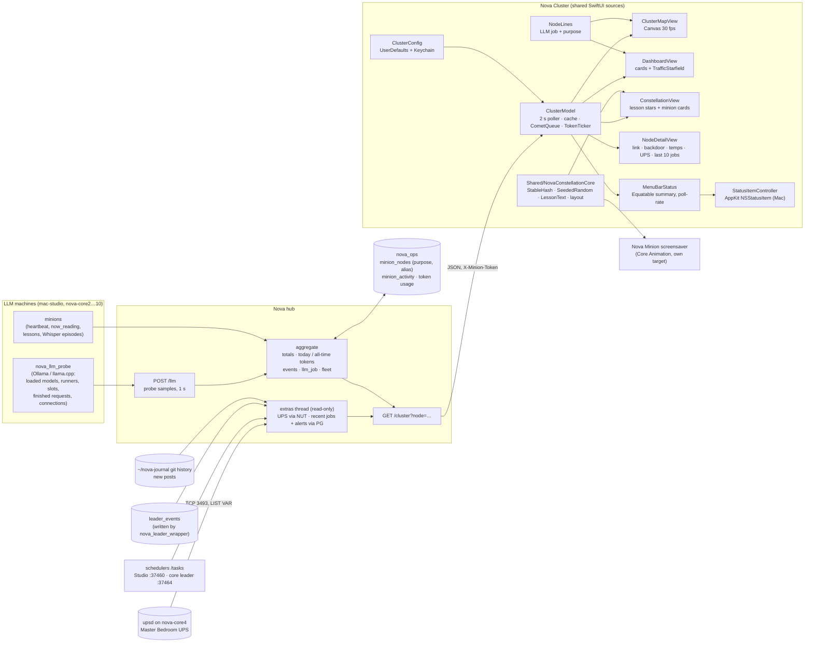
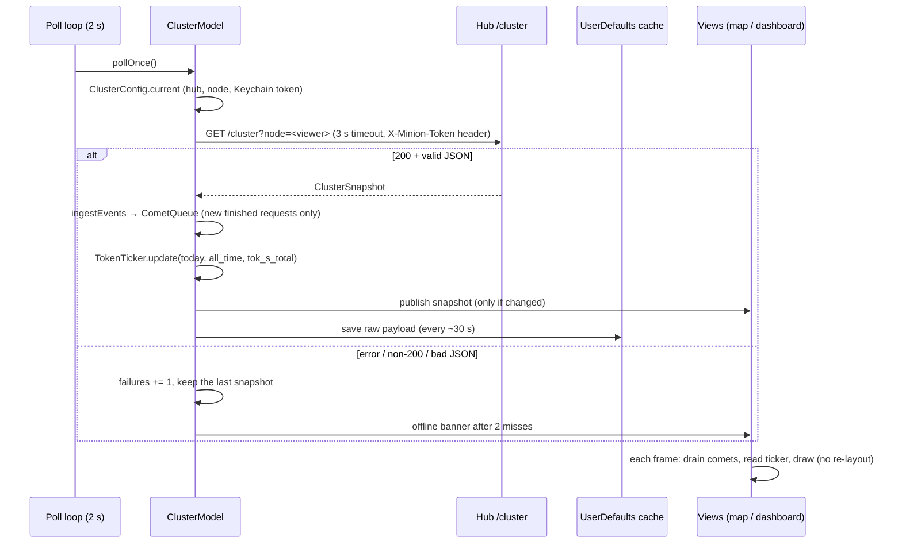

# Nova Cluster (Mac + iPad)

**Version 1.1.0 (build 3)** · macOS 14+ · iPadOS 17+ · SwiftUI · xcodegen

Nova Cluster is a live view of what every machine in Nova's cluster is doing with its language
models, and what that work turns into. Each machine's Ollama and llama.cpp traffic arrives from
Nova's hub every 2 s: the models in memory, the requests being served right now, and the finished
requests. So does the minions' reading work: current jobs, tonight's works and lessons, episodes
transcribed, and the latest lesson. The app only displays this data. It never computes or writes
anything back. Since 1.1.0 it also contains [Nova Minion](../NovaMinionPad/): the lesson
constellation is its third view, so one app shows the traffic and what the traffic turns into.

There is one multiplatform xcodegen project with two app targets that share every source in
`NovaCluster/`. Platform-specific code sits behind `#if os(iOS)` / `#if os(macOS)`.

| Target | Platform | Bundle id | Product |
|---|---|---|---|
| `NovaClusterMac` | macOS 14+ | `net.digitalnoise.NovaCluster` | `Nova Cluster.app` |
| `NovaClusterPad` | iPadOS 17+ | `net.digitalnoise.NovaClusterPad` | `NovaCluster.app` / `.ipa` |
| `NovaClusterTests` | macOS 14+ | `net.digitalnoise.NovaClusterTests` | XCTest bundle (not hosted in the app) |

## Features

### Every machine shows its LLM job and its core purpose (both views)

Each station label on the map and each machine card on the dashboard always carries two lines.
The lines have a fixed height, so the layout never moves when the text changes:

1. **▸ LLM job.** This is the hub's `llm_job.text`: the job that sent the request now running on this
   machine's LLM. Examples are `nova_notifier @ mac-studio → qwen3:8b · generating 52 tok`,
   `reading: <work>` and `transcribing (whisper): <episode>`. When nothing is running it shows
   `Idle · last: … · 4m ago`, `Idle · 2 models loaded`, `No LLM on this node` or
   `Silent · probe last heard …`. The hub names jobs from `minion_activity` and from the probes'
   connection tables (script and app names only). The app never guesses a job. A busy slot whose
   caller can't be matched says `caller not identified`. An older hub with no `llm_job` field falls
   back to what the snapshot itself shows.
2. **Core purpose.** This comes from `minion_nodes.purpose` in PG, for example
   `PG standby · Mosquitto · embeddings`. The machine's name includes its alias too, as in
   `mac-studio (nova-core8)` (`minion_nodes.alias`). To change either, run an `UPDATE minion_nodes …`.
   The app picks up the change on the next poll.

All hub text is treated as data, not markup. It is reduced to one clean line: control characters
and bidi overrides are removed and the length is capped at 240 characters. Long lines are truncated.
To see the full text, hover over it (Mac), tap a station on the map (both platforms), or long-press a
dashboard card (iPad).

### Three views

Tap the wordmark to step through **Cluster Map → Dashboard → Constellation**. On the Mac you can also use
**View › Cluster Map (⌘1) / Dashboard (⌘2) / Constellation (⌘3)**, or
`novacluster://view?mode=map|dashboard|constellation`. The app remembers your choice (`view.mode`).

#### Cluster map (`NOVA · CLUSTER`)

| Area | Shows |
|---|---|
| Hero (top left) | **Tokens today** across the cluster, shown as a rolling odometer. Between polls it ticks up at the live `tok_s_total` (decode + prefill), and at each poll it eases to the hub's figure. It never counts backwards, except at the daily reset, and it extrapolates at most 3 s past the last poll. The cluster's tok/s sits beside it and the all-time total sits under it. |
| Header tiles | LLM traffic: machines live, models loaded, model memory (GB), active requests and requests/min. Minions tonight: works, lessons, episodes transcribed (+ audio hours), and works still to read (+ ETA). |
| Map | mac-studio (Nova's hub) sits at the center and the other machines sit on a ring, Macs first. **Moons** are loaded models: size shows memory, color shows model family (legend at the bottom), and a hollow moon runs on the CPU. The hub splits its models across two rings. When a slot is busy its moon pulses. Prefill draws a filling amber arc (`prefill 46%`) and generation draws a spinning ring with the decoded count (`▸ 1,090 tok`). Flowing dashes run along a busy station's spoke. When a request finishes, a spark bursts at the station and a comet flies back to the hub, sized by prompt + decoded tokens. The hub's own requests send out a shock ring. |
| Stations | ● marks a minion. Its ring shows its state (solid = dedicated, dashed = idle, dotted = away), with a state badge, its current job (`› reading: …`, `› mapping: …`, `› transcribing: …`) and its tonight figures (`tonight: 96 works · 156 lessons` / `4 episodes · 1.6 h`). ◆ marks a service node (a plain LLM box) with a `FAST POOL` / `EMBEDDINGS` badge and its models. Every station shows chip · OS, RAM free/total · load, and tok/s · tokens today · req/min. A silent station (`live=false`) dims and shows `silent 42s`. |
| Hover / tap | On the Mac, hover over a moon. On the iPad, tap it. Shows the model, machine, GB (GPU or CPU), ctx, port and live slot progress. |
| Side panel | **Now generating** lists every busy slot, such as `qwen3:30b-a3b · nova-core10 · prefill 5,573/6,915` with a progress bar, or `generating 240 tok`. **Recent requests** shows the hub's finished-request log (model · node · prompt→decoded · age), with new rows sliding in. |
| Footer | The latest lesson the minions learned, which is what all the traffic is for. It steps through recent lessons every ~20 s. Also shows the model legend and either `live · 13:22` or `hub unreachable · last heard … · showing the last map`. |

#### Dashboard (`NOVA · DASHBOARD`, in Nova Minion's style)

- A **card per machine** across the top. Each card has the two fixed lines, live requests and
  minion jobs typed out terminal-style, loaded models, role · tokens today, and tonight's totals.
  On the Mac, hover over a card to see the full detail. On the iPad, long-press it (context menu).
- A **traffic starfield**: every finished request becomes a star in a drifting sky. Each machine's
  traffic forms its own constellation in that machine's hue. The hub comes first, and the same hues
  are used on the cards and in the legend.
- The **latest lesson** in large serif type, the tokens-today hero, and the cluster and fleet totals
  along the bottom.

#### Constellation (`NOVA · MINION`, Nova Minion folded in, 1.1.0)

| Area | Shows |
|---|---|
| Sky | Every lesson the minions learned is a star in the color of the machine that learned it (the same hues as the dashboard cards). Stars from the same work cluster and are joined by faint lines, over three slowly drifting parallax depths. New stars fade in; the star whose lesson is on stage gets a pulsing ring. Placement comes from the shared core in [`../Shared/`](../Shared/), the same code the Nova Minion screensaver uses, so a lesson sits in the same place on both. |
| Minion cards | One card per machine doing minion work: state dot (dedicated / idle / away / offline), tok/s, OS, `tonight:` totals, and up to three `reading:` / `transcribing:` lines typed out terminal-style. Mac: as many ~250 pt cards across as fit; iPad: 3 landscape / 2 portrait. |
| Lesson | The current lesson in large serif with `— from <title>`, kind · node · time. A brand-new lesson takes the stage at once; otherwise it steps through recent lessons every ~22 s. |
| Bottom | Machine legend and the fleet line: minions, works and lessons tonight, episodes transcribed, and the reading queue with its ETA. |

It reads the same `/cluster` poll as the other two views (no second hub client, no second token).

### Machine drill-down and the UPS (1.1.0)

Tap or click any machine (a station or its label on the map, a dashboard card, or a minion card), or open
`novacluster://node?name=nova-core7`, and a sheet shows that machine:

| Section | Shows |
|---|---|
| Now | Its LLM job line and its core purpose. |
| Link | **Ethernet**: interface, up/down, negotiated speed and address. **Wi-Fi backdoor**: whether the KOCH_5G-2 fallback is up and its address (red if down, amber if the machine has none). **Route**: which interface traffic uses; amber when it's going over Wi-Fi (the cable dropped or was demoted). |
| Temperatures | CPU, GPU, NVMe and NIC (Linux; macOS needs root, so Macs show none). Amber at 85 °C CPU/GPU or 70 °C NVMe. |
| Power | The UPS the machine is on: load %, watts, charge, runtime left, and on line / ON BATTERY / LOW BATTERY. |
| Machine | Chip · OS · cores, memory and load, loaded models. |
| Last 10 jobs | Newest first: LLM jobs (`nova_journal @ mac-studio → qwen3:8b`), works read for lessons (📖) and episodes transcribed (🎙). |

**On the map** a ⚡ follows the name of every machine on a monitored UPS, and the bottom-left badge reads
each UPS: `⚡ MASTER BEDROOM UPS 20% load · 180 W · 100% · 28 min · on line`.

The data comes from the hub (`/cluster`): probe 1.2 on each machine reports the link and temperatures; the
hub reads the UPS from NUT and the job history from PostgreSQL in a background thread. Taps on a moon still
show that model's tooltip.

### Alert strip (1.1.0)

When anything on Nova's schedulers is wrong, a capsule appears at the top centre of every view:
`● 2 DEAD-LETTER · 3 FAILING  studio · media_reingest_minions: failed 5× in a row`. It steps through the
problems every 5 s; tap it for the full list with each task's last error. It is red when anything is
dead-lettered, quarantined or unreachable, amber for failing tasks or a scheduler-core leader that isn't
nova-core, and hidden when all is well.

The hub builds it every 30 s from both schedulers' `/tasks` (the Studio's, and the scheduler-core leader's by
DNS name from `leader_standby`), with `scheduler_runs` as the fallback when a scheduler doesn't answer:
**dead-letter** = quarantined or 10+ failures in a row, **failing** = 3+. Leader changes in the last 7 days
come from `leader_events`, which `nova_leader_wrapper.py` writes on every takeover (seeded with the
10-18 16:36 failover to nova-core3 and the 10-19 18:00 hand-back).

### "Just published" ticker (1.1.0)

Under the alert strip, a slim line steps through Nova's newest posts on nova.digitalnoise.net every 8 s:
`JUST PUBLISHED  🔍 Belief and Friends: Garments, Gospel Arbitration… · 19:13`. A brand-new post jumps to the
front. Click (Mac) or tap (iPad) to open it in the browser; only `https://nova.digitalnoise.net/…` links are
ever opened. The hub reads the last 4 days of newly added posts from the journal repo's git history on the
Studio (title, section, emoji, link, publish time), skipping posts that have since moved.

### Menu-bar item (Mac, 1.1.0)

A menu-bar item shows fleet health at a glance: `⬢ 10/10`, or `⚠ 9/10 · 2!` when a machine is silent or a
scheduler alert is up. Its menu lists machines live, the scheduler alerts, each UPS
(`Master Bedroom UPS · 20% load · 180 W · 100% · 28 min · on line`), the newest post, **Open Nova Cluster (⌘O)**
and Quit. Turn it off in Settings › Menu bar. While it shows, closing the window keeps the app running there.

It is a plain AppKit `NSStatusItem` + `NSMenu`, **not** a SwiftUI `MenuBarExtra`: a 1.1.0 development build used
`MenuBarExtra`, whose label lives in the app's scene graph; every update made SwiftUI rebuild the main menu and
the app beach-balled (2026-10-19). The item reads `MenuBarStatus`, an Equatable summary the poller updates at
most once per 2 s poll and only when something actually changed (a unit test pins the rate).

**Hidden = idle.** On the Mac the window shows only its background while it can't be seen (app hidden, window
minimized or fully covered): canvases and timelines pause and the polls change no views; the full view rebuilds
the moment the window is visible again. Polling continues so the menu-bar item stays current. Verified: a
120 s hidden run under `sample` had the main thread 99.6% idle with zero main-menu rebuilds.

### Kiosk mode (1.1.0)

For the iPad on its stand, a Mac in full screen, or the Apple TV: the app steps
**Cluster Map → Dashboard → Constellation** every *N* seconds (default 60, 10–600 in Settings,
10–3600 by deep link).

- **Pause on touch.** Any touch (iPad), real pointer movement (Mac) or remote press (TV) pauses
  the cycle for two minutes, or for one interval if that is longer, so someone can study a view.
  Hover events caused by animation under a still cursor don't count.
- **Screen stays awake.** The iPad's idle timer is off while the app is in front (as before). On the
  Mac, kiosk mode holds a "Nova Cluster kiosk mode" display-sleep assertion, released when kiosk
  mode is turned off.
- **Turn it on:** Mac **View › Kiosk Mode (⇧⌘K)** or Settings › Kiosk; iPad long-press the wordmark ›
  Kiosk; or `novacluster://kiosk?on=1&interval=60`. The Apple TV starts in kiosk mode.
- The timing rule is `KioskPolicy` (pure, unit-tested); `ContentView` only runs it once a second.

### Resilience

- If the hub misses two polls in a row, the app shows the offline banner. It keeps drawing from the
  last snapshot.
- Every 30 s, the last good payload is cached in UserDefaults (`cluster.cache.v1`), so a cold launch
  shows the last map at once.
- Finished requests are de-duplicated by key. The first poll after launch only primes the list, so
  old traffic doesn't fire comets. New requests are spread across the 2 s interval (at most 24 per
  poll), so traffic reads as a steady stream rather than a pulse.

## Architecture



### Data flow per poll



## Mac app

The app installs to `/Volumes/Data/Applications/Nova Cluster.app`, with a symlink at
`/Applications/Nova Cluster.app`. It opens a resizable window (1440×900 at first, minimum 1000×680,
hidden title bar, always dark) that supports native full screen. **⌘,** opens Settings (hub URL,
viewer node, token and live status). **⌘R** polls now. Closing the window quits the app.

The hub and node live in UserDefaults (`hub.url`, `hub.node`; the default node is `mac-studio-view`).
The token lives in the login Keychain (service `net.digitalnoise.NovaCluster`, account
`cluster-token`). To preconfigure without opening Settings:

```sh
defaults write net.digitalnoise.NovaCluster hub.url "http://<hub-host>:<port>"
defaults write net.digitalnoise.NovaCluster hub.node mac-studio-view
security add-generic-password -U -s net.digitalnoise.NovaCluster -a cluster-token \
  -T "/Volumes/Data/Applications/Nova Cluster.app" -w "$(cat <token-file>)"
```

The `-T` flag lets the app read the item without a Keychain prompt. The app is signed with the team's
Apple Development identity, so the grant survives rebuilds.

## iPad app

The iPad app runs full screen, in landscape or portrait. The screen stays awake while the app is in
front, and the status bar is hidden. **Long-press the wordmark** to open Settings (the token is kept in
this iPad's Keychain, this-device-only). The default node is `ipad-air`. To configure it from the Mac:

```sh
xcrun devicectl device process launch --device <udid> --terminate-existing \
  --payload-url "novacluster://setup?hub=http://<hub-host>:<port>&node=ipad-air&token=$(cat <token-file>)" \
  net.digitalnoise.NovaClusterPad
```

On first launch iOS may ask for Local Network access. Tap **Allow**.

## Configuration

Nothing network-specific is compiled in. The hub can come from any of these sources:

| Source | How |
|---|---|
| Settings | Mac: ⌘, · iPad: long-press the wordmark |
| Deep link | `novacluster://setup?hub=…&node=…&token=…` (missing fields keep their current value) |
| Environment on launch | `NOVA_CLUSTER_HUB`, `NOVA_CLUSTER_NODE`, `NOVA_CLUSTER_TOKEN` (`DEVICECTL_CHILD_…` / `SIMCTL_CHILD_…`) |
| View switch | `novacluster://view?mode=map\|dashboard\|constellation` |
| Kiosk | `novacluster://kiosk?on=1&interval=60` |
| Drill-down | `novacluster://node?name=<node>` |
| Debug | `-demoBusy YES` marks a few slots busy (prefill + generating) to check the visuals |

## Security

- The token is stored only in the Keychain: the login keychain on macOS, and
  `kSecAttrAccessibleAfterFirstUnlockThisDeviceOnly` on iOS. No secrets or hosts are in the source.
- The token is sent in the `X-Minion-Token` header, never in the URL (covered by a test).
- Hub strings are cleaned before display. Control characters and bidi overrides are removed and the
  length is capped, so a node's name can't spoof the layout.
- ATS allows only local networking (`NSAllowsLocalNetworking`). The Mac app uses the hardened runtime.

## Build

```sh
cd apps/NovaCluster
xcodegen generate                      # project.yml is the source of truth; never hand-edit the pbxproj

# Mac
xcodebuild -project NovaCluster.xcodeproj -scheme NovaClusterMac -configuration Release \
  -destination 'generic/platform=macOS' -derivedDataPath <dd> -allowProvisioningUpdates build

# iPad
xcodebuild -project NovaCluster.xcodeproj -scheme NovaClusterPad -configuration Release \
  -destination 'generic/platform=iOS' -derivedDataPath <dd> -allowProvisioningUpdates build
xcrun devicectl device install app --device <udid> <dd>/Build/Products/Release-iphoneos/NovaCluster.app
```

Build both targets before you commit, because the sources are shared. Because the NAS mount is
unreliable, build from a local copy of the source with your own `-derivedDataPath`.

## Test

```sh
xcodebuild -project NovaCluster.xcodeproj -scheme NovaClusterMac -configuration Release \
  -destination 'platform=macOS' -derivedDataPath <dd> test
```

There are 45 XCTest cases (`Tests/NodeLinesTests.swift`, `Tests/ConstellationTests.swift`, `Tests/KioskTests.swift`, `Tests/NodeFactsTests.swift`), all of which pass in 1.1.0. The constellation tests pin the shared hash and random stream so the screensaver's sky can't shift silently. The test bundle
is not hosted in the app: it has no window, no live hub, and no real UserDefaults or Keychain. The
sources under test are compiled straight into the bundle. The network is stubbed with a `URLProtocol`.

| Category | Covers |
|---|---|
| Security | hub text becomes one clean bounded line · display names can't spoof lines · the token travels in a header, not the URL |
| Performance | decoding plus building lines stays fast (timed bound) · cleaning huge input stays bounded |
| Retry | failures count up and then recover with both lines · garbage keeps the last good snapshot |
| Unit | display name and alias · purpose fallback · state mapping |
| Integration | all ten nodes carry both lines · the cache goes only to the injected suite |
| Functional | hub job text is shown verbatim · an older hub never gets an invented job · detail has everything |
| Frame | height is fixed whatever the text · a narrow width still shows two lines |

## Release

1. Bump `MARKETING_VERSION` / `CURRENT_PROJECT_VERSION` in `project.yml`, then run `xcodegen generate`.
2. `xcodebuild archive` for both schemes, then `-exportArchive` with `method = debugging` (team `QRRCB8HB3W`).
3. Export to `/Volumes/Data/xcode/Binaries/YYYYMMDD-NovaCluster-vX.Y.Z/`, which holds `Nova Cluster.app`,
   `iPad/NovaCluster.ipa` + `iPad/NovaCluster.app`, and `NovaCluster-vX.Y.Z-buildN.dmg` (drag to Applications).
4. Copy the folder to `/Volumes/NAS/binaries/`. Wrap every NAS command in `timeout`.

## Performance

The animated layers draw in SwiftUI `Canvas` + `TimelineView`. The map runs at 30 fps and is rendered
through Metal with `drawingGroup`. The dashboard starfield also runs at 30 fps, the hero at 15 fps, and
the wordmark's breath at 10 fps. The map, starfield and hero pause when the scene is inactive. They have fixed sizes, so
a tick never re-lays out the window. Text and panels change only when a poll lands. Measured on the M3
Ultra at 1440×900 with live traffic, the app uses about 24–28 % of one core.

## Files

| File | Contents |
|---|---|
| `project.yml` | xcodegen spec: the Pad, Mac and Tests targets, Info.plist keys, signing and version |
| `NovaCluster/NovaClusterApp.swift` | app entry: iOS `WindowGroup` (idle timer off), macOS `Window` + `Settings` + View menu (⌘1/⌘2/⌘R) |
| `NovaCluster/Cluster.swift` | `/cluster` model, 2 s poller, offline cache, finished request → `CometQueue`, `TokenTicker`, `-demoBusy` |
| `NovaCluster/ClusterConfig.swift` | hub/node/token storage, Keychain, `novacluster://` deep links, environment setup |
| `NovaCluster/ClusterMap.swift` | station and moon view models, ring geometry, map renderer, station labels |
| `NovaCluster/NodeLines.swift` | per-machine LLM-job + purpose lines (text, cleaning, fixed-height view) |
| `NovaCluster/Views.swift` | root view (view switch), wordmark, header + odometer hero, side panel, footer, iPad settings sheet |
| `NovaCluster/DashboardView.swift` | Minion-style dashboard: machine hues, traffic starfield, machine cards, lesson, totals |
| `NovaCluster/Palette.swift` | palette, model-family hues, number and age formatting, dust layer |
| `NovaClusterMac/MacSettings.swift` | macOS Settings window |
| `NovaCluster/Assets.xcassets`, `NovaClusterMac/Assets.xcassets` | iPad and macOS app icons |
| `Tests/NodeLinesTests.swift` | XCTest suite covering all 7 categories |

## Version history

| Version | Date | Notes |
|---|---|---|
| 1.0.1 (2) | 2026-10-17 | Every machine shows its LLM job and core purpose in both views; release build is clean; 17/17 tests pass; DMG |
| 1.0.0 (1) | 2026-10-16 | First release: live Mac + iPad view of the whole cluster's LLM traffic |
