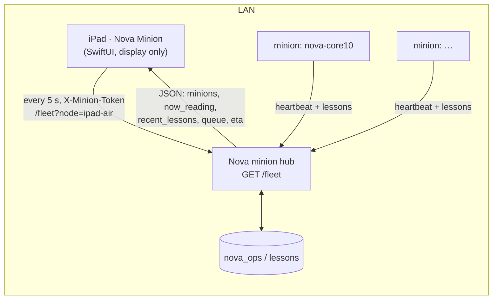

# Nova Minion — iPad

A full-screen, display-only iPad app for Nova's minion fleet. It sits on a stand,
plugged in, and shows what Nova's machines are reading and learning: a drifting
constellation where every lesson is a star (colored by the minion that learned it),
a card per minion, the latest lesson in large serif type, and fleet totals.
The iPad does no compute — it only polls Nova's hub.

Companion to the macOS screensaver in `apps/NovaMinionSaver/` (same look).



## Screen

| Area | Shows |
|---|---|
| Background | Starfield (SwiftUI `Canvas` + `TimelineView`, 30 fps, paused when not active). Stars of the same work are linked by faint lines; each minion has its own hue (legend at the bottom; `hub` = lessons with no node). |
| Top strip | One card per minion: node, state dot (dedicated / idle / away / offline), tok/s, `tonight: N works · M lessons`, and `now_reading` lines typed out terminal-style. |
| Center-lower | Current lesson (citation markers like `[3][12]` stripped), `— from <title>`, kind · node · time. A brand-new lesson takes the stage at once; otherwise it steps through recent lessons every ~22 s. |
| Bottom | Fleet totals and queue (`34,080 still to read (~52 days)`). When the hub can't be reached: `Nova is resting` — the sky keeps drifting on cached data. |
| Wordmark | Breathing `NOVA · MINION`. **Long-press it** for settings. |

The screen stays awake while the app is in the foreground; the status bar and home
indicator are hidden. For a kiosk stand, use **Settings › Accessibility › Guided Access**.

## Setup

Nothing network-specific is compiled in. Configure the hub one of three ways:

1. **Settings sheet** — long-press the wordmark; enter hub URL, node, token.
2. **Deep link** — `novaminion://setup?hub=http://<hub-host>:<port>&node=ipad-air&token=<token>`.
   From the Mac, without touching the iPad:
   ```sh
   xcrun devicectl device process launch --device <udid> --terminate-existing \
     --payload-url "novaminion://setup?hub=…&node=ipad-air&token=$(cat <token-file>)" \
     net.digitalnoise.NovaMinion
   ```
3. **Environment on first launch** — `NOVA_MINION_HUB`, `NOVA_MINION_NODE`, `NOVA_MINION_TOKEN`
   (e.g. `SIMCTL_CHILD_…` for the simulator, `DEVICECTL_CHILD_…` for devices).

Hub + node are stored in UserDefaults; the token in the iOS Keychain
(`net.digitalnoise.NovaMinion` / `minion-token`, this-device-only).
The first launch shows iOS's **Local Network** prompt — tap **Allow**.

## Build

```sh
xcodegen generate
# simulator
xcodebuild -scheme NovaMinionPad -destination 'platform=iOS Simulator,name=iPad Air 11-inch (M4)' build
# device (automatic signing)
xcodebuild -scheme NovaMinionPad -configuration Release -destination 'id=<udid>' -allowProvisioningUpdates build
xcrun devicectl device install app --device <udid> <DerivedData>/Build/Products/Release-iphoneos/NovaMinion.app
```

Debug launch arguments:

- `-demoMinions 3` — fakes extra minions (and spreads lessons across them) to check layout.
- `-simLandscape YES` — lays the UI out landscape inside a portrait window (simulators
  without a Simulator.app can't rotate); rotate the screenshot afterwards.

## Files

- `NovaMinionPad/Fleet.swift` — `/fleet` model, poller (5 s, 4 s timeout), offline cache, demo mode.
- `NovaMinionPad/MinionConfig.swift` — hub/node/token config, deep link, Keychain.
- `NovaMinionPad/Starfield.swift` — palette, node colors, constellation model + renderer.
- `NovaMinionPad/Views.swift` — layout, cards, lesson panel, bottom bar, settings.
