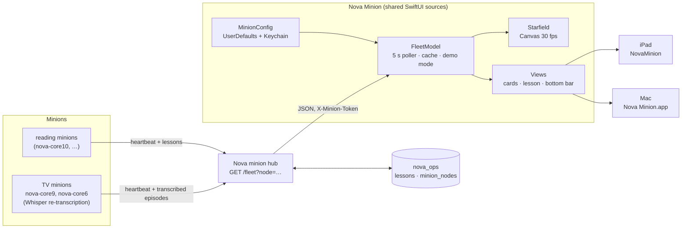
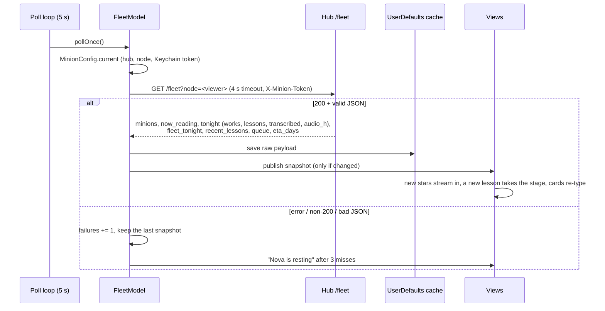

# Nova Minion (iPad + Mac)

> **Superseded (2026-10-19).** Nova Minion's constellation is now the third view of
> [Nova Cluster 1.1.0](../NovaCluster/) (**Constellation**, ⌘3 on the Mac, or tap the wordmark),
> fed by the same `/cluster` poll as the map and dashboard. This project is kept until the
> combined app has replaced it on every device; new work goes into Nova Cluster. The
> screensaver ([`../NovaMinionSaver/`](../NovaMinionSaver/)) is still its own target and now
> places stars with the shared core in [`../Shared/`](../Shared/).

**Version 1.0.1 (build 2)** · iPadOS 17+ · macOS 14+ · SwiftUI · xcodegen

Nova Minion is a display-only window onto Nova's minion fleet: the machines that read works and turn
them into lessons, and the TV minions that re-transcribe episodes with Whisper. The iPad version sits
on a stand, plugged in. The Mac version is a native window onto the same view. Both show a drifting
constellation where every lesson is a star, colored by the minion that learned it. They also show a
card per minion, the latest lesson in large serif type, and the fleet totals. Neither does any
compute. They only poll Nova's hub.

There is one multiplatform xcodegen project. Both targets share every source in `NovaMinionPad/`, and
platform-specific code sits behind `#if os(iOS)` / `#if os(macOS)`. The project is a companion to the
macOS screensaver in [`apps/NovaMinionSaver/`](../NovaMinionSaver/), which has the same look.

| Target | Platform | Bundle id | Product |
|---|---|---|---|
| `NovaMinionPad` | iPadOS 17+ | `net.digitalnoise.NovaMinion` | `NovaMinion.app` / `.ipa` |
| `NovaMinionMac` | macOS 14+ | `net.digitalnoise.NovaMinionMac` | `Nova Minion.app` |

## Features

| Area | Shows |
|---|---|
| Background | A starfield drawn with SwiftUI `Canvas` + `TimelineView` at 30 fps, paused when the scene isn't active. Stars from the same work are linked by faint lines. Each minion has its own hue (legend at the bottom; `hub` means lessons with no node). Star placement is stable across launches because it is seeded by a hash of the work. |
| Top strip | One card per minion. Each card shows the node, a state dot (dedicated / idle / away / offline), tok/s, OS (`macOS 26.6`, `Ubuntu 26.04.1`), a `tonight:` line, and `now_reading` lines typed out terminal-style (`reading: …` / `transcribing: …`). The tonight line reads `81 works · 106 lessons`. A minion that only transcribes shows `4 episodes transcribed · 1.6 h audio` instead, and one doing both shows `81 works · 106 lessons · 4 episodes`. On the iPad the cards sit in 3 columns in landscape and 2 in portrait. On the Mac, as many ~250 pt cards fit as the width allows (5 across at 1440 wide), wrapping when the window is narrower. Every card in a row has the same height. |
| Center-lower | The current lesson, with citation markers like `[3][12]` stripped, then `— from <title>` and kind · node · time. A brand-new lesson takes the stage at once. Otherwise the view steps through recent lessons every ~22 s. |
| Bottom | Fleet totals, transcription when there is any (`15 episodes (6.9 h) transcribed`), and the queue (`34,080 still to read (~52 days)`). When the hub can't be reached it shows `Nova is resting · last heard …`, and the sky keeps drifting on cached data. |
| Wordmark | `NOVA · MINION`, breathing slowly. **Long-press it** to open Settings. On the Mac you can also double-click it or press ⌘,. |

**iPad.** The screen stays awake while the app is in the foreground, and the status bar and home
indicator are hidden. For a kiosk stand, turn on **Settings › Accessibility › Guided Access**.

**Mac.** The app installs to `/Volumes/Data/Applications/Nova Minion.app`, with a symlink at
`/Applications/Nova Minion.app`. It opens a resizable window (1440×900 at first, minimum 900×600, hidden
title bar, always dark) that supports native full screen (green button or ⌃⌘F). **⌘,** opens the
standard Settings window (hub URL, node, token and live status). **View › Refresh Now (⌘R)** polls
immediately. Closing the window quits the app. The Mac keeps polling and drawing while the window is
up, but it doesn't keep the display awake.

**Resilience.** Every good `/fleet` payload is cached in UserDefaults (`fleet.cache.v1`), so a cold
launch shows the last sky at once. The app treats the hub as offline after 3 misses in a row, or after
the first miss if it has never reached the hub.

## Architecture



### Data flow per poll



### `/fleet` contract (all fields optional)

```json
{ "updated": "…",
  "minions": [{ "node": "nova-core10", "state": "dedicated|idle|away|offline", "since": "…",
                "dedicated": true, "os": "macOS 26.6", "tok_s": 58.2,
                "now_reading": [{ "title": "…", "kind": "film", "phase": "reading|mapping|transcribing", "started": "…" }],
                "tonight": { "works": 81, "lessons": 106, "transcribed": 4, "audio_h": 1.6 } }],
  "fleet_tonight": { "works": 210, "lessons": 640, "minions": 5, "transcribed": 15, "audio_h": 6.9 },
  "recent_lessons": [{ "title": "…", "kind": "film", "lesson": "…", "node": "nova-core10", "at": "…" }],
  "queue": { "A": 34080 }, "eta_days": 52 }
```

## Configuration

Nothing network-specific is compiled in. You can configure the hub in any of these ways:

1. **Settings.** On the iPad, long-press the wordmark. On the Mac, press ⌘, or double-click the wordmark.
2. **Deep link** (iPad): `novaminion://setup?hub=http://<hub-host>:<port>&node=ipad-air&token=<token>`.
   Missing fields keep their current value. To send it from the Mac without touching the iPad:
   ```sh
   xcrun devicectl device process launch --device <udid> --terminate-existing \
     --payload-url "novaminion://setup?hub=…&node=ipad-air&token=$(cat <token-file>)" \
     net.digitalnoise.NovaMinion
   ```
3. **Environment on launch:** `NOVA_MINION_HUB`, `NOVA_MINION_NODE`, `NOVA_MINION_TOKEN`
   (use `SIMCTL_CHILD_…` for the simulator and `DEVICECTL_CHILD_…` for devices).
4. **Mac, from a shell:**
   ```sh
   defaults write net.digitalnoise.NovaMinionMac hub.url "http://<hub-host>:<port>"
   defaults write net.digitalnoise.NovaMinionMac hub.node mac-studio-view
   security add-generic-password -U -s net.digitalnoise.NovaMinionMac -a minion-token \
     -T "/Volumes/Data/Applications/Nova Minion.app" -w "$(cat <token-file>)"
   ```
   The `-T` flag lets the app read the item without a Keychain prompt. The app is signed with the
   team's Apple Development identity, so the grant survives rebuilds.

The hub and node are stored in UserDefaults (`hub.url`, `hub.node`; the default node is `ipad-air` on
the iPad and `mac-view` on the Mac). On first launch the iPad shows iOS's **Local Network** prompt. Tap
**Allow**.

Debug launch arguments:

- `-demoMinions 3` fakes extra minions, and spreads the lessons across them, so you can check the layout.
- `-simLandscape YES` lays the UI out in landscape inside a portrait window, for simulators that can't
  rotate. Rotate the screenshot afterwards.

## Security

- The token is stored only in the Keychain: the login keychain on the Mac (service
  `net.digitalnoise.NovaMinionMac`, account `minion-token`), and on the iPad under
  `net.digitalnoise.NovaMinion` / `minion-token` with `kSecAttrAccessibleAfterFirstUnlockThisDeviceOnly`.
- The token is sent in the `X-Minion-Token` header, never in the URL. No hosts or secrets are in the
  source.
- ATS allows only local networking (`NSAllowsLocalNetworking`). The Mac app uses the hardened runtime.

## Build

```sh
cd apps/NovaMinionPad
xcodegen generate                      # project.yml is the source of truth; never hand-edit the pbxproj

# Mac
xcodebuild -project NovaMinionPad.xcodeproj -scheme NovaMinionMac -configuration Release \
  -destination 'generic/platform=macOS' -derivedDataPath <dd> -allowProvisioningUpdates build

# iPad: simulator / device
xcodebuild -project NovaMinionPad.xcodeproj -scheme NovaMinionPad \
  -destination 'platform=iOS Simulator,name=iPad Air 11-inch (M4)' build
xcodebuild -project NovaMinionPad.xcodeproj -scheme NovaMinionPad -configuration Release \
  -destination 'generic/platform=iOS' -derivedDataPath <dd> -allowProvisioningUpdates build
xcrun devicectl device install app --device <udid> <dd>/Build/Products/Release-iphoneos/NovaMinion.app
xcrun devicectl device process launch --device <udid> --terminate-existing net.digitalnoise.NovaMinion
```

Build both targets before you commit, because the sources are shared. Because the NAS mount is
unreliable, build from a local copy of the source with your own `-derivedDataPath`.

## Test

This project has no XCTest target yet. To check a change:

1. Build both schemes in Release. They must finish with no warnings or errors.
2. Run the Mac app against the live hub, and again with `-demoMinions 5`, to check the card layout at
   several window widths.
3. Run the iPad app in the simulator, using `-simLandscape YES` for the landscape layout.

## Release

1. Bump `MARKETING_VERSION` / `CURRENT_PROJECT_VERSION` in `project.yml`, then run `xcodegen generate`.
2. `xcodebuild archive` for each scheme, then `-exportArchive` with `method = debugging` (team `QRRCB8HB3W`).
3. Mac: `/Volumes/Data/xcode/Binaries/YYYYMMDD-NovaMinionMac-vX.Y.Z/` holds `Nova Minion.app` and
   `NovaMinionMac-vX.Y.Z-buildN.dmg` (drag to Applications).
   iPad: `/Volumes/Data/xcode/Binaries/YYYYMMDD-NovaMinionPad-vX.Y.Z/` holds `NovaMinion.ipa` and `NovaMinion.app`.
4. Copy both folders to `/Volumes/NAS/binaries/`. Wrap every NAS command in `timeout`.

## Files

| File | Contents |
|---|---|
| `project.yml` | xcodegen spec: the iPad and Mac targets, Info.plist keys, signing and version |
| `NovaMinionPad/NovaMinionApp.swift` | app entry: iOS `WindowGroup` (idle timer off, `-simLandscape`), macOS `Window` + `Settings` + ⌘R |
| `NovaMinionPad/Fleet.swift` | `/fleet` model (including `transcribed` / `audio_h`), 5 s poller with a 4 s timeout, offline cache, demo mode, citation stripping |
| `NovaMinionPad/MinionConfig.swift` | hub/node/token config, `novaminion://` deep link, environment setup, Keychain |
| `NovaMinionPad/Starfield.swift` | palette, node colors, stable hashing, constellation model + renderer |
| `NovaMinionPad/Views.swift` | layout (iPad + Mac), minion cards, typed lines, lesson panel, bottom bar, iPad settings sheet |
| `NovaMinionMac/MacSettings.swift` | macOS Settings window |
| `NovaMinionMac/Assets.xcassets` | macOS app icon (rounded, generated from the iPad icon) |
| `NovaMinionMac/Info.plist`, `NovaMinionPad/Info.plist` | generated by xcodegen from `project.yml` |

## Version history

| Version | Date | Notes |
|---|---|---|
| 1.0.1 (2) | 2026-10-17 | Transcription shown on the cards and status line; minion OS on each card; native macOS target; release build is clean; DMG |
| 1.0.0 (1) | 2026-10-16 | First release: full-screen iPad display for Nova's minion fleet |
