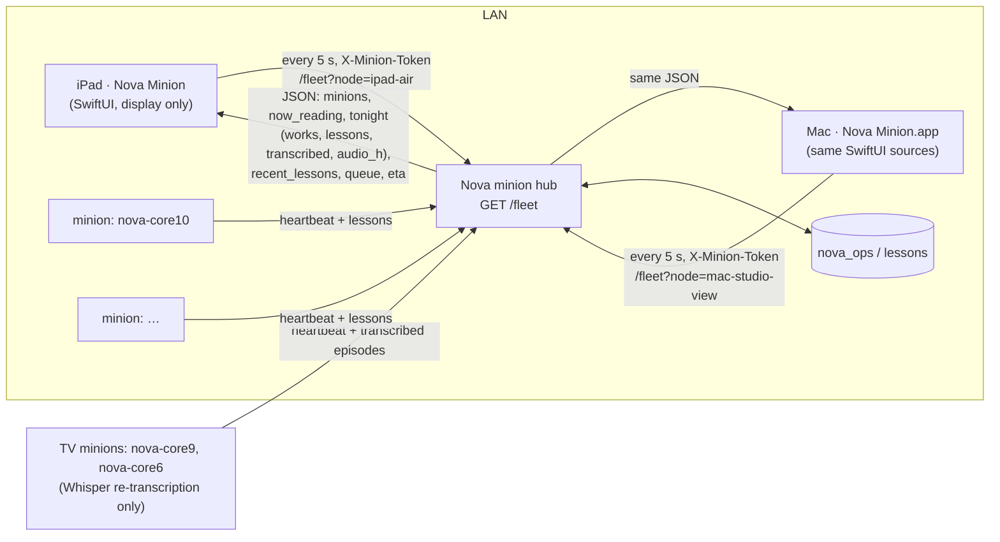

# Nova Minion — iPad + Mac

A full-screen, display-only iPad app (and a native macOS window onto the same view) for Nova's minion fleet. It sits on a stand,
plugged in, and shows what Nova's machines are reading and learning: a drifting
constellation where every lesson is a star (colored by the minion that learned it),
a card per minion, the latest lesson in large serif type, and fleet totals.
Neither does any compute — they only poll Nova's hub. One multiplatform xcodegen project:
the `NovaMinionPad` (iOS 17+) and `NovaMinionMac` (macOS 14+) targets share every source in
`NovaMinionPad/`; platform bits are behind `#if os(iOS)` / `#if os(macOS)`.

Companion to the macOS screensaver in `apps/NovaMinionSaver/` (same look).



## Screen

| Area | Shows |
|---|---|
| Background | Starfield (SwiftUI `Canvas` + `TimelineView`, 30 fps, paused when not active). Stars of the same work are linked by faint lines; each minion has its own hue (legend at the bottom; `hub` = lessons with no node). |
| Top strip | One card per minion: node, state dot (dedicated / idle / away / offline), tok/s, OS, a `tonight:` line, and `now_reading` lines typed out terminal-style (`reading: …` / `transcribing: …`). Tonight line: `81 works · 106 lessons`; a transcription-only minion (no works) shows `4 episodes transcribed · 1.6 h audio`; one doing both shows `81 works · 106 lessons · 4 episodes`. iPad: 3 columns landscape / 2 portrait. Mac: as many ~250 pt cards as fit (5 across at 1440 wide), wrapping when narrower; every card in a row has the same height. |
| Center-lower | Current lesson (citation markers like `[3][12]` stripped), `— from <title>`, kind · node · time. A brand-new lesson takes the stage at once; otherwise it steps through recent lessons every ~22 s. |
| Bottom | Fleet totals, transcription when any (`15 episodes (6.9 h) transcribed`), and queue (`34,080 still to read (~52 days)`). When the hub can't be reached: `Nova is resting` — the sky keeps drifting on cached data. |
| Wordmark | Breathing `NOVA · MINION`. **Long-press it** for settings (Mac: also double-click, or ⌘,). |

The screen stays awake while the app is in the foreground; the status bar and home
indicator are hidden. For a kiosk stand, use **Settings › Accessibility › Guided Access**.

## Mac app

`Nova Minion.app` (`net.digitalnoise.NovaMinionMac`): a resizable window (opens at 1440×900,
minimum 900×600, hidden title bar, always dark) with native full screen (green button / ⌃⌘F).
**⌘,** opens the standard Settings window (hub URL, node, token + live status);
**View › Refresh Now (⌘R)** polls immediately. Closing the window quits. The Mac keeps polling
and drawing whenever the window is up; it does not hold the display awake.

Hub + node live in the app's UserDefaults (`hub.url`, `hub.node`); the token in the login
Keychain, service `net.digitalnoise.NovaMinionMac`, account `minion-token`. To preconfigure
without opening Settings:

```sh
defaults write net.digitalnoise.NovaMinionMac hub.url "http://<hub-host>:<port>"
defaults write net.digitalnoise.NovaMinionMac hub.node mac-studio-view
security add-generic-password -U -s net.digitalnoise.NovaMinionMac -a minion-token \
  -T "/Volumes/Data/Applications/Nova Minion.app" -w "$(cat <token-file>)"
```

`-T` lets the app read the item without a Keychain prompt (the app is signed with the
team's Apple Development identity, so the grant survives rebuilds).

## Setup (iPad)

Nothing network-specific is compiled in. Configure the hub one of three ways:

1. **Settings sheet** — long-press the wordmark; enter hub URL, node, token.
2. **Deep link** — `novaminion://setup?hub=http://<hub-host>:<port>&node=ipad-air&token=<token>`.
   From the Mac, without touching the iPad:
   ```sh
   xcrun devicectl device process launch --device <udid> --terminate-existing \
     --payload-url "novaminion://setup?hub=…&node=ipad-air&token=$(cat <token-file>)" \
     net.digitalnoise.NovaMinion
   ```
3. **Environment on first launch** — `NOVA_MINION_HUB`, `NOVA_MINION_NODE`, `NOVA_MINION_TOKEN`
   (e.g. `SIMCTL_CHILD_…` for the simulator, `DEVICECTL_CHILD_…` for devices).

Hub + node are stored in UserDefaults; the token in the iOS Keychain
(`net.digitalnoise.NovaMinion` / `minion-token`, this-device-only).
The first launch shows iOS's **Local Network** prompt — tap **Allow**.

## Build

```sh
xcodegen generate
# Mac (Apple Development signing, team in project.yml) → install on /Volumes/Data
xcodebuild -scheme NovaMinionMac -configuration Release -destination 'platform=macOS' \
  -derivedDataPath <dd> -allowProvisioningUpdates build
ditto "<dd>/Build/Products/Release/Nova Minion.app" "/Volumes/Data/Applications/Nova Minion.app"
open "/Volumes/Data/Applications/Nova Minion.app"
# binaries: copy to /Volumes/Data/xcode/binaries/NovaMinionMac/, zip (ditto -c -k --keepParent)
# for /Volumes/NAS/binaries/NovaMinionMac/ — the NAS adds metadata that breaks signatures
# simulator
xcodebuild -scheme NovaMinionPad -destination 'platform=iOS Simulator,name=iPad Air 11-inch (M4)' build
# device (automatic signing)
xcodebuild -scheme NovaMinionPad -configuration Release -destination 'id=<udid>' -allowProvisioningUpdates build
xcrun devicectl device install app --device <udid> <DerivedData>/Build/Products/Release-iphoneos/NovaMinion.app
xcrun devicectl device process launch --device <udid> --terminate-existing net.digitalnoise.NovaMinion
```

Build both targets before committing — the sources are shared.

Debug launch arguments:

- `-demoMinions 3` — fakes extra minions (and spreads lessons across them) to check layout.
- `-simLandscape YES` — lays the UI out landscape inside a portrait window (simulators
  without a Simulator.app can't rotate); rotate the screenshot afterwards.

## Files

- `NovaMinionPad/NovaMinionApp.swift` — app entry: iOS `WindowGroup`; macOS `Window` + `Settings` scenes, ⌘R command.
- `NovaMinionPad/Fleet.swift` — `/fleet` model (incl. optional `transcribed` / `audio_h`), poller (5 s, 4 s timeout), offline cache, demo mode.
- `NovaMinionPad/MinionConfig.swift` — hub/node/token config, deep link, Keychain.
- `NovaMinionPad/Starfield.swift` — palette, node colors, constellation model + renderer.
- `NovaMinionPad/Views.swift` — layout (iPad + Mac), cards, lesson panel, bottom bar, iPad settings sheet.
- `NovaMinionMac/MacSettings.swift` — macOS Settings window.
- `NovaMinionMac/Assets.xcassets` — macOS app icon (rounded, generated from the iPad icon).
- `NovaMinionMac/Info.plist` — generated by xcodegen from `project.yml`.
