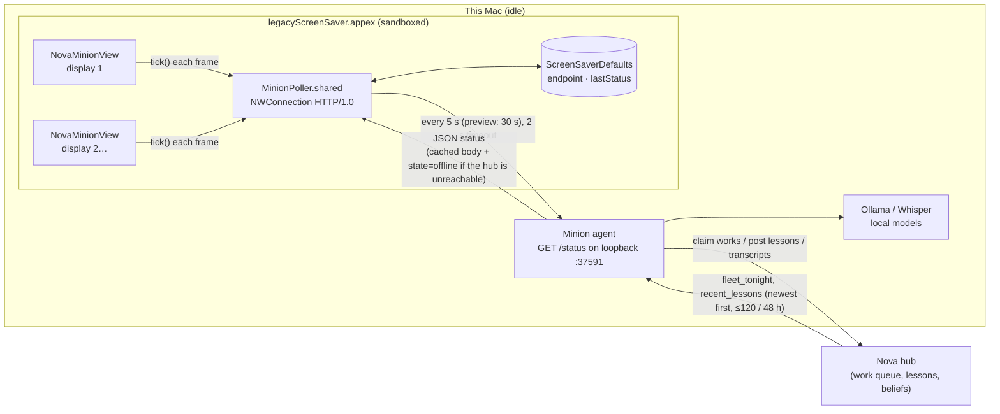
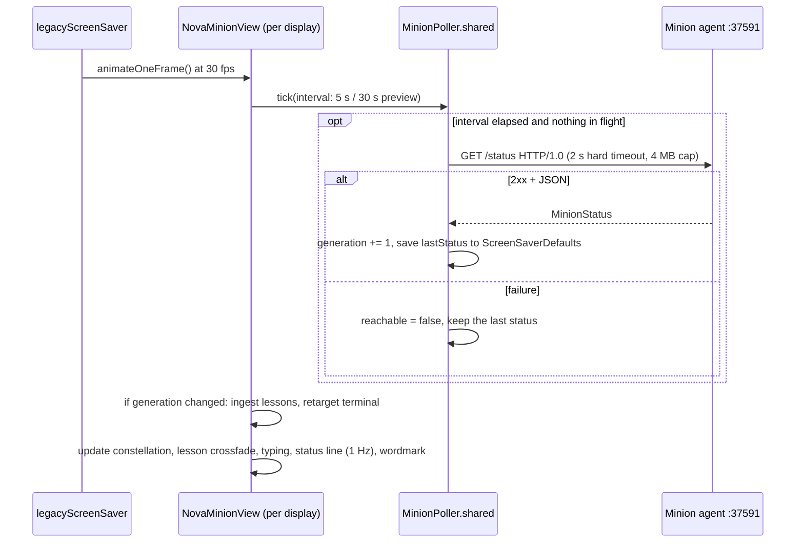

# Nova Minion screensaver

**Version 1.0.1 (build 2)** · macOS 14+ · `NovaMinion.saver` (`com.jordankoch.NovaMinion`) · Swift + Core Animation · xcodegen

A macOS screensaver that shows what this Mac is doing for Nova while it sits idle, in the spirit of
SETI@home and Folding@home. It reads the local minion agent's status and draws the lessons the fleet
is learning as a living constellation. It is a sibling of the [Nova Minion iPad/Mac app](../NovaMinionPad/)
and has the same look.

## Features

- **Constellation.** Every lesson Nova learns is a star. Stars learned on *this* Mac glow warm amber,
  and stars from the rest of the fleet glow cool blue. Faint lines join lessons from the same work.
  Each new lesson streaks in from the sky and settles into the field. After a long sleep, a big
  backlog appears directly and only the newest 8 streak in. Works sit at three parallax depths that
  drift slowly. The field holds at most 300 stars, and the oldest fade out first.
- **Lesson.** The latest lessons rotate every 12 s in large serif type with a crossfade, followed by
  "— from *title*". Citation markers like `[3][12]` are removed, and text is capped at 300 characters.
  New lessons jump the rotation queue, and a halo marks the star that belongs to the lesson on screen.
- **Terminal** (top left). The header is `nova minion · <node> · <os> · <state>`. Up to four
  `now_reading` lines are typed out with a blinking cursor: `› reading: The Godfather (film) · mapping…`,
  or `› transcribing: <episode>` on a Whisper minion. The terminal also shows the model and tok/s. Only
  the part of the text that changed is retyped.
- **Status line** (bottom), refreshed every second. A reading minion shows
  `This Mac has read 37 works for Nova tonight · 112 lessons · 9 beliefs · 58 tok/s · fleet: 3 minions, 210 works · 33,912 still to read (~25 days)`.
  A Whisper minion, one that transcribes and reads no works, shows
  `This Mac has transcribed 4 episodes for Nova tonight · 1.6 h of audio`, and the fleet part adds
  `N episodes transcribed`. The first phrase is accented in amber.
- **Resting.** When the agent can't be reached, or reports `state: "offline"`, the status line reads
  `Nova minion is resting · last heard 5 min ago`. The sky keeps drifting from the last cached payload.
- **NOVA wordmark** (top right). It breathes slowly over a 9 s cycle.
- **Preview** (System Settings thumbnail). Type is larger relative to the frame, the terminal is hidden,
  and the saver polls every 30 s instead of every 5 s.

## Architecture



The saver only reads data. It never writes to the agent or to the hub.

### Data flow per frame



## Data contract (`GET /status`)

Every field is optional. A missing field, or one with the wrong type, is skipped:

```json
{ "node": "nova-core10", "state": "idle|away|dedicated|offline", "since": "…", "os": "macOS 26.6",
  "now_reading": [{"title": "The Godfather", "kind": "film", "phase": "reading|mapping|transcribing", "started": "…"}],
  "tonight": {"works": 37, "lessons": 112, "beliefs": 9, "transcribed": 4, "audio_h": 1.6},
  "fleet_tonight": {"works": 210, "lessons": 640, "minions": 3, "transcribed": 15, "audio_h": 6.9},
  "recent_lessons": [{"title": "…", "kind": "film", "lesson": "…", "node": "…", "at": "…", "mine": true}],
  "tok_s": 58.2, "model": "qwen3:30b-a3b",
  "queue": {"A": 33912, "B": 131291, "C": 297515}, "eta_days": 24.8, "updated": "…" }
```

## Configuration

The saver has no configure sheet. The endpoint defaults to the loopback interface on port 37591, path
`/status`. The address is assembled at runtime, because repo hooks reject IP literals. To override it,
set the `endpoint` key in the saver's `ScreenSaverDefaults` (module `com.jordankoch.NovaMinion`). Inside
legacyScreenSaver, that key lives in the host's sandbox container:

```sh
defaults -currentHost write ~/Library/Containers/com.apple.ScreenSaver.Engine.legacyScreenSaver/Data/Library/Preferences/ByHost/com.jordankoch.NovaMinion endpoint "http://<host>:37591/status"
```

## Sandbox, network and security notes

- Third-party savers run inside Apple's sandboxed `legacyScreenSaver.appex`. That host has the
  `com.apple.security.network.client` entitlement, so outbound connections work.
- The host's Info.plist has no App Transport Security exceptions, and we can't add any. The poller
  therefore sends a hand-written HTTP/1.0 GET over `NWConnection` instead of using `URLSession`, so ATS
  doesn't apply to plain-HTTP loopback. Loopback is also exempt from the Local Network privacy prompt,
  so no TCC dialog appears.
- The saver holds no secrets or tokens. The loopback agent needs no authentication, and only 2xx
  bodies of 4 MB or less are parsed.
- The cache (`lastStatus` in ScreenSaverDefaults) lands in the legacyScreenSaver container, not in
  `~/Library/Preferences`.
- On Sonoma and later, legacyScreenSaver keeps view instances alive after the saver is dismissed. The
  view pauses on `com.apple.screensaver.willstop`, so orphaned instances stop polling and animating.
- With several displays, each display gets its own view, and each view draws independently. All of
  them share one poller, so together they cost one request every 5 s.

## Build and install

```sh
zsh tools/build.sh            # the NAS mount is noexec, so call it through zsh
NO_INSTALL=1 zsh tools/build.sh
```

The script runs `xcodegen generate`, then builds a universal Release (arm64 + x86_64). It ad-hoc signs
the bundle (`codesign -s - --deep`) and installs it to `~/Library/Screen Savers/NovaMinion.saver`. It
also exports `NovaMinion.saver` and `NovaMinion-saver-<version>.zip` to `/Volumes/Data/xcode/binaries/`
and `/Volumes/NAS/binaries/`. To choose the saver, open **System Settings → Screen Saver → Other**. The
script does **not** change the active screensaver.

To build by hand from a local copy, which is safer while the NAS mount is unreliable:

```sh
xcodegen generate
xcodebuild -project NovaMinionSaver.xcodeproj -scheme NovaMinion -configuration Release \
  -destination 'generic/platform=macOS' -derivedDataPath <dd> build
codesign --force --deep -s - <dd>/Build/Products/Release/NovaMinion.saver
ditto <dd>/Build/Products/Release/NovaMinion.saver ~/Library/Screen\ Savers/NovaMinion.saver
```

Release folders are named `/Volumes/Data/xcode/Binaries/YYYYMMDD-NovaMinionSaver-vX.Y.Z/` and hold
`NovaMinion.saver` and `NovaMinion-saver-X.Y.Z.zip`. Copy each one to `/Volumes/NAS/binaries/`.

## Test without watching a screensaver

The project has no XCTest target. Use the mock agent and the offscreen harness instead:

```sh
python3 tools/mock_minion.py &                       # serves on loopback :37591
swiftc -O tools/snapshot.swift -o <out>/snapshot -framework ScreenSaver
<out>/snapshot --saver ~/Library/Screen\ Savers/NovaMinion.saver --out <frames> --at 2,8,20
<out>/snapshot --saver … --out <frames> --prefix preview --size 300x200 --preview --at 10
<out>/snapshot --saver … --out <frames> --prefix offline --endpoint http://<loopback>:37599/status --at 8
curl 'http://<loopback>:37591/control?mode=offline'  # the agent reports state=offline (hub unreachable)
curl 'http://<loopback>:37591/control?mode=down'     # /status returns 503 (the saver sees it as unreachable)
```

The mock also accepts `--offline-every 60` and `--seed-lessons 40`. To measure CPU without taking
snapshots, run the harness with `--duration 40 --at 999`. Measured on an M-series Mac at 1920×1080 and
30 fps, steady state is about 1.2–1.8 % of one core in-process. Compositing happens in the render server
on the GPU.

## Files

| Path | Contents |
|---|---|
| `project.yml` | XcodeGen spec: bundle target, `.saver` wrapper, `NSPrincipalClass = NovaMinionView`, version |
| `NovaMinion/NovaMinionView.swift` | `ScreenSaverView` subclass: layers, lesson rotation, terminal, status line, wordmark, willstop pause |
| `NovaMinion/Constellation.swift` | star field: clustering, parallax depths, twinkle groups, streak arrivals, lines, 300-star cap |
| `NovaMinion/MinionPoller.swift` | one shared poller per process, a minimal HTTP/1.0 client on Network.framework, last-good cache |
| `NovaMinion/MinionStatus.swift` | tolerant JSON model (including transcription, OS and beliefs) |
| `NovaMinion/Render.swift` | pre-rendered sprites, text images, vignette, dust |
| `tools/mock_minion.py` | mock minion agent: evolving fake data, plus `/control?mode=online\|offline\|down` |
| `tools/snapshot.swift` | offscreen harness: loads the `.saver`, runs it at 30 fps, writes PNG frames and a CPU figure |
| `tools/build.sh` | builds a universal Release, ad-hoc signs it, installs it, and exports the binaries |

## Version history

| Version | Date | Notes |
|---|---|---|
| 1.0.1 (2) | 2026-10-17 | Whisper minions show episodes transcribed and hours of audio; the fleet line counts them; minion OS in the terminal header; release build is clean |
| 1.0.0 (1) | 2026-10-16 | First release: a constellation of the lessons this Mac learns for Nova |
