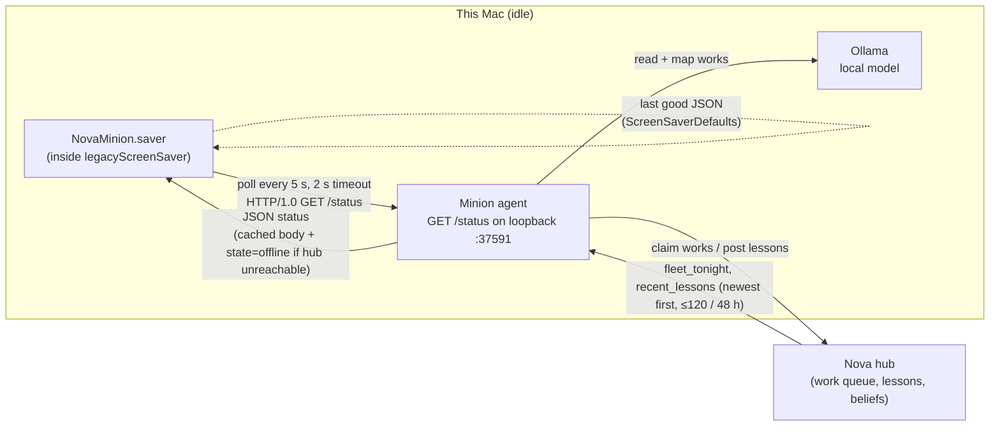

# Nova Minion — screensaver

A macOS screensaver (`NovaMinion.saver`) that shows what this Mac is doing for Nova while it sits idle, in the spirit of SETI@home and Folding@home.

- **Constellation.** Every lesson Nova learns is a star. Stars learned on *this* Mac glow warm amber, and stars from the rest of the fleet glow cool blue. Faint lines join lessons from the same work. Each new lesson streaks in from the sky and settles into the field. Works sit at three parallax depths that drift slowly. The field holds at most 300 stars, and the oldest fade out first.
- **Lesson.** The latest lessons rotate every 12 s in large serif type with a crossfade, followed by "— from *title*". Citation markers like `[3][12]` are removed. A halo marks the star that belongs to the lesson on screen.
- **Terminal** (top-left). Shows `reading: The Godfather (film) · mapping…`, typed out with a blinking cursor.
- **Status line** (bottom). Shows works and lessons tonight, tok/s, fleet size, and how many works are still to read. When the minion can't be reached, or reports `state: "offline"`, it reads "Nova minion is resting" and the sky keeps drifting from the last cached payload.
- **NOVA wordmark** (top-right). Breathes slowly.

## How it fits together



The saver only reads data. It never writes to the agent or the hub.

## Data contract

Every field is optional. A missing field, or one with the wrong type, is skipped:

```json
{ "node": "nova-core10", "state": "idle|away|dedicated|offline", "since": "…",
  "now_reading": [{"title": "The Godfather", "kind": "film", "phase": "reading|mapping", "started": "…"}],
  "tonight": {"works": 37, "lessons": 112, "beliefs": 9},
  "fleet_tonight": {"works": 210, "lessons": 640, "minions": 3},
  "recent_lessons": [{"title": "…", "kind": "film", "lesson": "…", "node": "…", "at": "…", "mine": true}],
  "tok_s": 58.2, "model": "qwen3:30b-a3b",
  "queue": {"A": 33912, "B": 131291, "C": 297515}, "eta_days": 24.8, "updated": "…" }
```

## Layout

| Path | What |
|---|---|
| `project.yml` | XcodeGen spec (bundle target, `.saver` wrapper, `NSPrincipalClass = NovaMinionView`) |
| `NovaMinion/NovaMinionView.swift` | `ScreenSaverView` subclass: layers, lesson rotation, terminal, status line, wordmark |
| `NovaMinion/Constellation.swift` | Star field: clustering, parallax depths, twinkle groups, streak arrivals, lines |
| `NovaMinion/MinionPoller.swift` | One shared poller per process, a minimal HTTP/1.0 client on Network.framework, and the last-good cache |
| `NovaMinion/MinionStatus.swift` | Tolerant JSON model |
| `NovaMinion/Render.swift` | Pre-rendered sprites, text images, vignette, dust |
| `tools/mock_minion.py` | Mock minion agent: evolving fake data, plus `/control?mode=online|offline|down` |
| `tools/snapshot.swift` | Offscreen harness: loads the `.saver`, runs it at 30 fps, and writes PNG frames and a CPU figure |
| `tools/build.sh` | Builds a universal Release, ad-hoc signs it, installs it, and exports the binaries |

## Build and install

```sh
zsh tools/build.sh            # the NAS mount is noexec, so call it through zsh
```

The script runs `xcodegen` and then builds a Release (arm64 + x86_64) into `/Volumes/Data/xcode/DerivedData/NovaMinionSaver`. It ad-hoc signs the bundle (`codesign -s - --deep`) and installs it to `~/Library/Screen Savers/NovaMinion.saver`. It exports `NovaMinion.saver` and `NovaMinion-saver-<version>.zip` to `/Volumes/Data/xcode/binaries/` and `/Volumes/NAS/binaries/`. To choose it, open System Settings → Screen Saver → Other. The script does **not** change the active screensaver.

## Test without watching a screensaver

```sh
python3 tools/mock_minion.py &                       # serves on loopback :37591
swiftc -O tools/snapshot.swift -o /tmp/snapshot -framework ScreenSaver
/tmp/snapshot --saver ~/Library/Screen\ Savers/NovaMinion.saver --out /tmp/frames --at 2,8,20
/tmp/snapshot --saver … --out /tmp/frames --prefix preview --size 300x200 --preview --at 10
/tmp/snapshot --saver … --out /tmp/frames --prefix offline --endpoint http://<loopback>:37599/status --at 8
curl 'http://<loopback>:37591/control?mode=offline'  # agent reports state=offline (hub unreachable)
```

`--duration 40 --at 999` runs the harness without snapshots, for CPU measurement. Measured on an M-series Mac at 1920×1080 and 30 fps, steady state is about 1.2–1.8 % of one core in-process. Compositing happens in the render server on the GPU.

## Configuration

There is no configure sheet. The endpoint defaults to the loopback interface on port 37591, path `/status`. To override it, set the `endpoint` key in the saver's `ScreenSaverDefaults` (module `com.jordankoch.NovaMinion`). Inside legacyScreenSaver that key lives in the host's sandbox container:

```sh
defaults -currentHost write ~/Library/Containers/com.apple.ScreenSaver.Engine.legacyScreenSaver/Data/Library/Preferences/ByHost/com.jordankoch.NovaMinion endpoint "http://<host>:37591/status"
```

## Sandbox and network notes

- Third-party savers run inside Apple's sandboxed `legacyScreenSaver.appex`. That host has the `com.apple.security.network.client` entitlement, so outbound connections work.
- The host's Info.plist has no App Transport Security exceptions, and we can't add any to it. The poller therefore uses `NWConnection` with a hand-written HTTP/1.0 GET instead of `URLSession`, which means ATS doesn't apply to plain-HTTP loopback. Loopback is also exempt from the Local Network privacy prompt, so there's no TCC dialog. That prompt is the issue that tripped up RTSP Rotator's LAN streams.
- The cache (`lastStatus` in ScreenSaverDefaults) lands in the legacyScreenSaver container, not in `~/Library/Preferences`.
- On Sonoma and later, legacyScreenSaver keeps view instances alive after the saver is dismissed. The view pauses on `com.apple.screensaver.willstop` so orphaned instances stop polling and animating.
- With several displays, each display gets its own view, and each view draws independently. All of them share one poller, so they cost one request every 5 s. The System Settings preview (`isPreview`) uses larger relative type, hides the terminal, and polls every 30 s.
